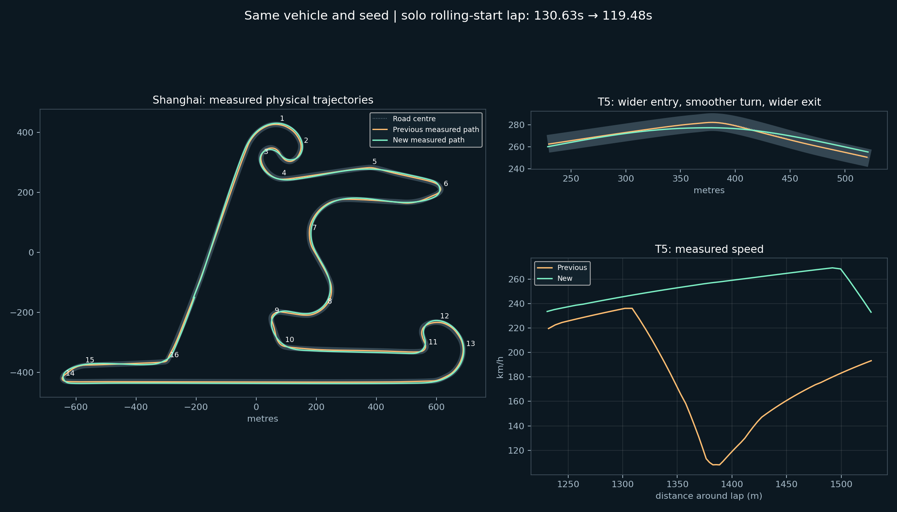

# Shanghai Racing Path — 7d46953990b00bbd

วันที่ 27 ตุลาคม 2026 (ประเทศไทย). พัฒนาบน develop/f1m-engine-1.0 จากเกมเดิม; main ไม่เปลี่ยน

## สิ่งที่เปลี่ยน

- ใช้ไลน์แบบสัมพันธ์กับระยะทางบนสนาม: จุดเลี้ยว/apex/ทางออกไม่เลื่อนตามเวลาที่เปลี่ยนเลน
- สร้าง spline 902 จุดแบบ offline โดยลดความโค้ง ความโค้งแหลม และระยะทาง ภายในขอบควบคุม ±5.4 ม. มีข้อจำกัดไม่ให้เส้นพับกลับบนโค้งแคบ
- เส้นเข้าร่วมไลน์ถูกยึดจุดเริ่มครั้งเดียวและจำกัดความชัน ให้รถค่อย ๆ ตามเส้นเดียวกัน จังหวะรถใกล้กัน/แซงใช้ corridor เดิมและเปลี่ยนกลับได้อย่างจำกัด
- ระบบตรวจรถหน้าใช้ความตั้งใจตามไลน์ร่วมกัน เพราะรถบนไลน์เดียวกันอาจอยู่คนละ offset เมื่ออยู่คนละตำแหน่งของโค้ง
- วาง speed envelope จากเส้นเดียวกับที่รถตาม และคงค่าแรงเกาะ/กำลัง/เบรกของรุ่น 55360261f03d23c7
- ปรับจุดเริ่ม recovery สำหรับ Shanghai จากกลางถนน 4.65 ม. เป็น 6.0 ม. เพื่อไม่เรียก recovery ขณะวิ่งไลน์ที่ยังอยู่บนถนน ตรวจขอบตัวรถจริงในชุดทดสอบเพิ่มเติม
- ออกจากไลน์แข่งเมื่อเตรียมเข้าพิต เพื่อให้กลับมาตั้งรถตามทางเข้าพิตได้

ภาพด้านล่างมาจากตำแหน่งรถที่ผ่านฟิสิกส์จริงในแบบจำลอง ไม่ใช่ภาพเกม 3D และไม่ได้วาดรถให้เดินตามเส้นโดยข้ามฟิสิกส์

## ผลก่อน–หลัง

เงื่อนไขเหมือนกัน: seed 7, ฟิสิกส์เดิม, ถนนแห้ง, เริ่มแบบ rolling สำหรับแถววิ่งเดี่ยว ไม่ใช่ Android benchmark

| การวัด | รุ่น 55360261f03d23c7 | รุ่นนี้ |
|---|---:|---:|
| วิ่งเดี่ยวหนึ่งรอบแบบ rolling | 130.633 s | 119.483 s |
| รอบบินดีที่สุดจากรอบ 2–3 | 132.976 s | 120.576 s |
| สัดส่วนตัวอย่างรถเดี่ยวที่ห่างกลางถนนเกิน 3.1 ม. | 0.0% | 72.1% |
| แข่ง 6 คันหนึ่งรอบ จนจบครบ | 158.867 s | 149.900 s |

ช่วง bin 50 ม. ที่ครอบคลุม T5: รุ่นเดิมต่ำสุดประมาณ 108 กม./ชม.; รุ่นนี้ประมาณ 253 กม./ชม. และไม่เบรกใน bin ดังกล่าว ตัวเลขนี้ไม่ใช่ความเร็วต่ำสุดของทั้ง sector

## สิ่งที่ทดสอบผ่าน

- วิ่งเดี่ยว 3 รอบ: ไม่มี rejection/stop
- แข่ง 6 คันหนึ่งรอบ seed 7 และ 19: จบครบ, ไม่หลุดขอบตัวรถ, ไม่มี rejection/stop/retirement, มีการแซง 3 ครั้ง
- แข่ง 6 คันสองรอบ: จบครบใน 296.983 s, แซง 9 ครั้ง, ไม่มี rejection/stop/retirement, มุมรถไกลกลางถนนสูงสุด 6.831 ม. เทียบกับครึ่งความกว้างถนน 7.7 ม. ตรวจทุก 0.1 วินาที ไม่ใช่พิสูจน์ continuous collision ทุกเวลา
- เข้า pit ถึง SERVICE: station error -0.025 ม., lateral 0.339 ม., ไม่มี rejection
- 1,980 แผนเข้าร่วมไลน์ (หลายความเร็วและมุมรถ) และ 1,638 แผนต่างตำแหน่ง/ยางสึก/offset ผ่าน validator
- ไลน์ไม่มีการกลับทิศของพิกัด offset ในการสุ่มทุก 0.5 ม.; maximum offset 5.4 ม.
- npm test, PWA cache/update unit tests, build และ diff checks ผ่าน

## ประสิทธิภาพและข้อจำกัด

สร้างไลน์ล่วงหน้านอกเกม ไม่แก้ความละเอียดภาพ เงา ระยะมองเห็น หรือจำนวนรถ งานวางแผนใน Node เพิ่มจาก 0.376 เป็น 0.402 ms/plan ใน microbenchmark 1,000 แผนหลัง warm-up (ประมาณ +0.026 ms/plan). ค่านี้ไม่ใช่ FPS มือถือและยังไม่ยืนยัน Android หลังอัปเดต

ยังไม่ถึงเป้าหมาย 1:35 และไม่รับรองว่าเป็นไลน์เร็วที่สุดแบบ global optimum. ยังไม่ทดสอบครบทุกสภาพฝน/คำสั่งทีม/เหตุฉุกเฉินหรือพิสูจน์ความปลอดภัยทุกสถานการณ์

## ทำซ้ำ

- `F1M_TRACK23=shanghai node tests/path-grid-drive.mjs`
- `F1M_TRACK23=shanghai AUDIT_LAPS=2 node tests/path-grid-drive.mjs`
- `F1M_TRACK23=shanghai node tests/shanghai-flying-lap.mjs`
- `F1M_TRACK23=shanghai node tests/path-geometry.mjs`
- `F1M_TRACK23=shanghai node tests/path-transitions.mjs`
- `F1M_TRACK23=shanghai node tests/shanghai-envelope.mjs`
- สร้าง candidate ใหม่: `python tools/optimise-shanghai-curvature.py` (ต้องมี numpy/scipy และ Node). Solver เริ่มจาก candidate ปัจจุบัน; ผลใหม่ต้องทดสอบซ้ำก่อนใช้
- บันทึก/วาดเส้นรถจริง: `F1M_TRACK23=shanghai node tools/trace-shanghai-line.mjs`, แล้ว `python tools/plot-shanghai-line.py` (matplotlib/numpy)
